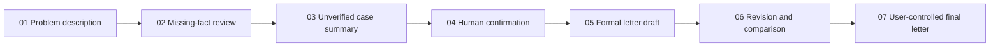
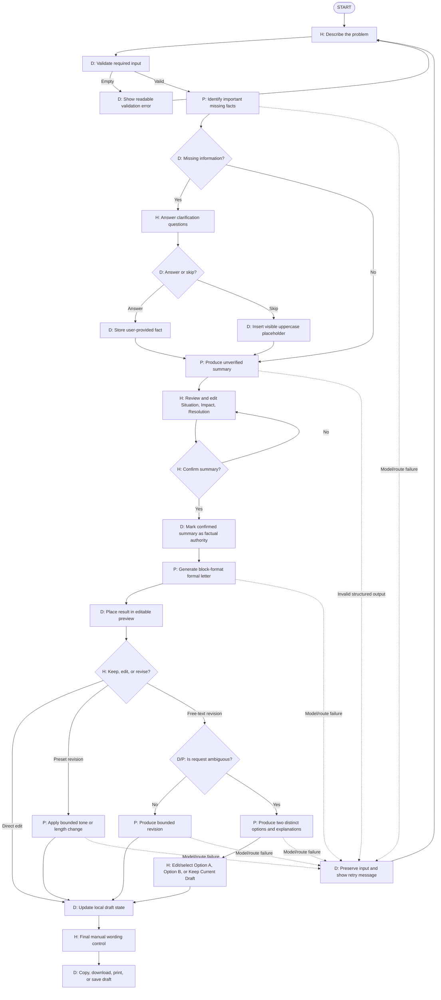

# GhostWriter Detailed System Map

## Legend

- **D — Deterministic:** interface, validation, state, routing, storage, and user-selected actions.
- **P — Probabilistic:** Gemini interpretation, question generation, summarization, drafting, and revision alternatives.
- **H — Human judgment:** factual answers, confirmation, tone choice, option selection, direct editing, and final use.

## High-level logic

## Detailed behavior, routing, and decisions

## Information boundaries

### Sent to Gemini when required

- current problem description;
- current optional sender and recipient fields;
- answers supplied for the current clarification step;
- the current unverified or confirmed summary, depending on the route;
- the current letter and the current revision request during refinement;
- the selected tone.

### Not sent automatically

- unrelated saved drafts;
- unrelated scenarios or prior sessions;
- local browser history;
- the user's Gemini API key (the key stays server-side and is used only to authenticate the API call);
- facts that the user skipped—these remain visible placeholders rather than hidden guesses.

## Human-control boundary

The model may propose questions, summaries, letters, and revision alternatives. The user decides which facts are true, whether the summary is confirmed, which revision option is applied, and what final wording leaves the system. A generated draft is not treated as verified evidence merely because the model or build panel says it completed successfully.

